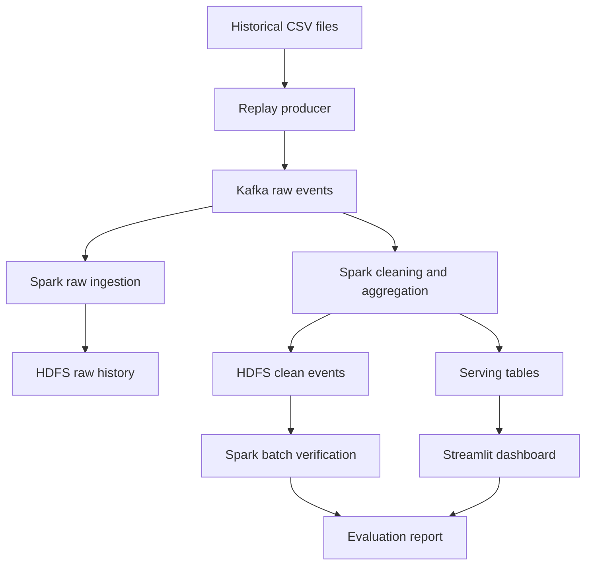

# Real-Time E-commerce User Behavior Analytics Using Kafka, Spark and Hadoop

An academic Big Data Processing project that replays historical cosmetics-store events, processes them with Spark, stores event history in Hadoop HDFS, and presents behavioral metrics on a dashboard.

**Status: starter repository.** The local CSV validation and replay utilities are included. A Kafka-to-Parquet ingestion example is provided for integration. The complete distributed deployment, cleaned streaming analytics, dashboard, and benchmark results are still team deliverables.

## Dataset

The project uses [eCommerce Events History in Cosmetics Shop](https://www.kaggle.com/datasets/mkechinov/ecommerce-events-history-in-cosmetics-shop), published by Michael Kechinov, with source credit to [REES46](https://rees46.com/). The publisher describes approximately 20 million events covering October 2019 through February 2020. This is historical data; real-time behavior is simulated through controlled replay.

Keep the downloaded CSV files outside Git. Only a small **synthetic** fixture is included. See [dataset setup](docs/DATASET.md) and the [data dictionary](docs/DATA_DICTIONARY.md).

## Objectives

- Build a continuous ingestion path from CSV replay to Kafka and Spark.
- Preserve raw events and build a cleaned, deduplicated analytical layer in HDFS.
- Analyze views, cart additions, cart removals, purchases, active users, and product popularity.
- Define session-based conversion metrics without treating purchase-event counts as order counts.
- Evaluate correctness, throughput, latency, recovery, and resource usage.

## Planned architecture



The raw-ingestion example implements only the path from Kafka to raw Parquet storage. Other branches are planned. PostgreSQL is the proposed serving store; its implementation is not included yet. See [architecture](docs/ARCHITECTURE.md).

## Team

| Member | Primary ownership |
| --- | --- |
| Thái | Dataset profiling, event contract, CSV replay, test fixtures |
| Anh | Kafka, deployment configuration, integration environment |
| Quyền | Spark Structured Streaming, validation, deduplication, aggregation |
| Quyết | HDFS, Parquet layout, historical analysis, batch verification |
| Phương | Dashboard, metric definitions, benchmarks, demo coordination |

Detailed tasks and acceptance criteria: [team assignments](docs/TEAM_ASSIGNMENTS.md).

## Run the local examples

Use Python 3.10 or later. Run these commands from the repository root. The following checks need neither Kafka nor external Python packages:

```bash
python -m unittest discover -s tests -v
python -m src.producer.replay --dry-run --max-events 8 --rate 0
```

The second command prints JSON events to standard output and a summary to standard error. It uses the included synthetic CSV. A rate of zero disables throttling.

For Kafka publishing, install the optional client, start a broker, and create the topic before running:

```bash
python -m pip install -r requirements.txt
python -m src.producer.replay --config config/project.example.json
```

See [setup](docs/SETUP.md) for a real-data replay command and the Spark ingestion example. No broker or HDFS service is started automatically.

## Repository guide

| Path | Purpose |
| --- | --- |
| `docs/` | Dataset, architecture, team tasks, milestones, metrics, setup |
| `config/project.example.json` | Example replay settings; command-line options override them |
| `schemas/event.schema.json` | JSON Schema for the normalized producer event |
| `data/sample/events_sample.csv` | Eight synthetic events for local verification |
| `src/common/events.py` | CSV validation and deterministic event identity |
| `src/producer/replay.py` | Rate-limited dry-run or Kafka publishing |
| `src/streaming/kafka_to_bronze.py` | Raw Kafka-to-Parquet integration example |
| `infra/`, `src/batch/`, `src/dashboard/` | Implementation contracts for remaining modules |
| `tests/` | Local contract and replay checks |
| `.github/` | Task template, pull-request template, local-check workflow |

## Implementation status

| Component | Status |
| --- | --- |
| Documentation, team ownership, event contract | Included |
| Local normalization and dry-run replay | Implemented and locally checked |
| Kafka publishing | Implemented; broker integration must be verified |
| Raw Kafka-to-Parquet Spark job | Example included; cluster integration must be verified |
| Kafka and HDFS deployment | Planned; Anh and Quyết |
| Clean streaming analytics and recovery validation | Planned; Quyền |
| Historical batch verification | Planned; Quyết |
| Dashboard and benchmark measurements | Planned; Phương |

The repository contains no measured performance results and makes no end-to-end exactly-once claim.

## Project documents

- [Four-week plan](docs/PROJECT_PLAN.md)
- [Metrics and evaluation](docs/METRICS_AND_EVALUATION.md)
- [Contributing](CONTRIBUTING.md)
- [Upload to GitHub](docs/GITHUB_UPLOAD.md)
- [Sources and attribution](docs/SOURCES.md)

